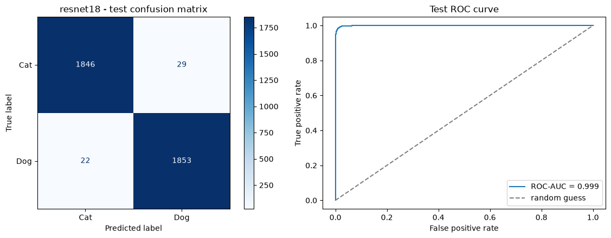
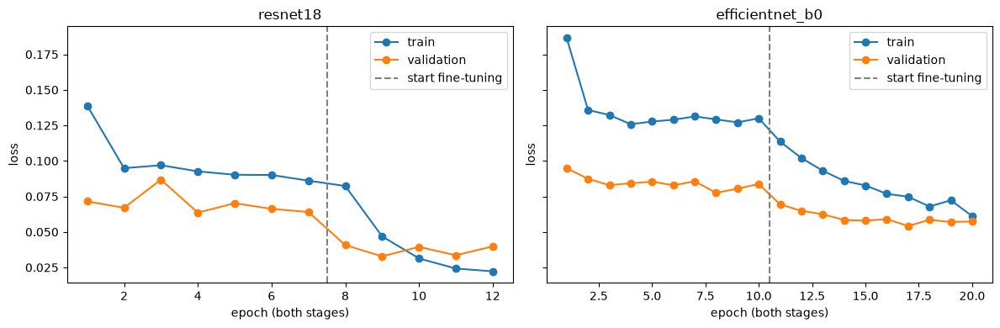

# Cats and Dogs Classification

Classifies images as cat or dog using transfer learning in PyTorch, comparing ResNet-18 and EfficientNet-B0.

**Result:** ResNet-18 reached **98.6% accuracy** and **0.999 ROC-AUC** on 3,750 held-out test images, against a 50% baseline.

**Stack:** Python, PyTorch, torchvision, scikit-learn, pandas, matplotlib

[View the notebook](Cats-and-Dogs-Classification.ipynb)

## Data

[Dog and Cat Classification Dataset](https://www.kaggle.com/datasets/bhavikjikadara/dog-and-cat-classification-dataset) (Kaggle): 24,998 images, with 12,499 in each class.

Images were split 70/15/15 with stratification:

| Split | Images | Transforms |
|---|---|---|
| Train | 17,498 | Resize to 224×224, horizontal flip, ±10° rotation, color jitter, ImageNet normalization |
| Validation | 3,750 | Resize to 224×224, ImageNet normalization |
| Test | 3,750 | Resize to 224×224, ImageNet normalization |

## Approach

Both models started from ImageNet-pretrained weights and were trained in two stages:

| Stage | Trainable layers | Learning rate | Maximum epochs |
|---|---|---|---|
| 1. Feature extraction | New output layer only | 1e-3 | 10 |
| 2. Fine-tuning | Output layer and top block | 1e-4 | 10 |

- **Training:** AdamW, batch size 32, class-weighted cross-entropy
- **Early stopping:** patience of 3 epochs on validation loss, restoring the best weights
- **Model selection:** best validation ROC-AUC
- **Final check:** the test set was used only after selection, on the chosen model

## Results

Validation comparison:

| Model | Accuracy | ROC-AUC | PR-AUC | Macro F1 |
|---|---|---|---|---|
| Baseline | 0.500 | 0.500 | – | – |
| **ResNet-18** | **0.986** | **0.999** | **0.999** | **0.986** |
| EfficientNet-B0 | 0.980 | 0.998 | 0.998 | 0.980 |

The margin between the two models is small. ResNet-18 was chosen for its higher validation ROC-AUC.

ResNet-18 on the test set:

| Accuracy | ROC-AUC | PR-AUC | Macro F1 |
|---|---|---|---|
| 0.986 | 0.999 | 0.999 | 0.986 |

Of 3,750 test images, 51 were misclassified: 29 cats predicted as dogs and 22 dogs predicted as cats.



Fine-tuning lowered the loss for both models. Early stopping ended ResNet-18's training as its training loss fell below its validation loss, an early sign of overfitting.



## Debugging note

An earlier run applied ImageNet normalization to training images only, so the models were evaluated on differently scaled inputs. Validation loss stayed well above training loss, especially for EfficientNet-B0. Adding normalization to the validation, test and inference transforms raised EfficientNet-B0's validation accuracy from 76.2% to 98.0%, and ResNet-18's test accuracy from 96.6% to 98.6%.

## Inference

The saved checkpoint was reloaded and used to classify 8 new images from `testing_images/`, writing the results to `predictions.csv`. Four were predicted as cats and four as dogs. Seven had a confidence of 1.000 after rounding, and one was at 0.969.

## Limitations and next steps

- **Error analysis:** review the 51 misclassified test images for label errors and hard cases.
- **Reproducibility:** seed NumPy and the data loaders as well as PyTorch.

## Project structure

```
├── Cats-and-Dogs-Classification.ipynb
├── requirements.txt
├── resnet18_best.pt       # created by the notebook
├── predictions.csv        # created by the notebook
├── assets/                # README images
├── testing_images/        # new images for inference
└── data/
    ├── Cat/
    └── Dog/
```

## How to run

1. Download the dataset from Kaggle and place the `Cat` and `Dog` folders in `data/`.
2. Open `Cats-and-Dogs-Classification.ipynb` and run all cells.

The first cell reinstalls PyTorch from the CUDA 13.4 wheels, so change its index URL if your hardware differs. The results here used an NVIDIA GPU with Python 3.14.
